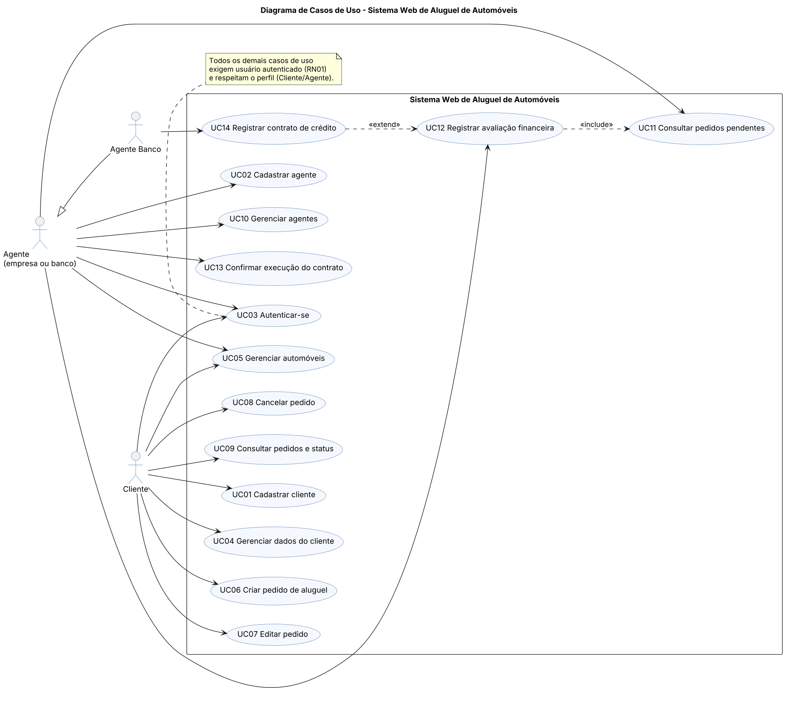
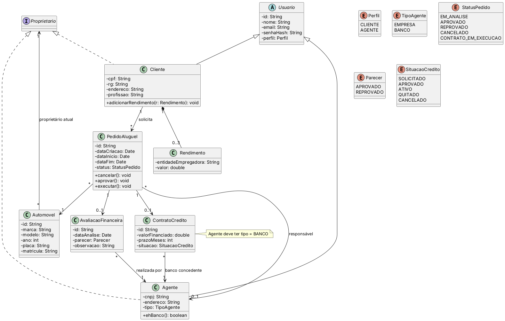
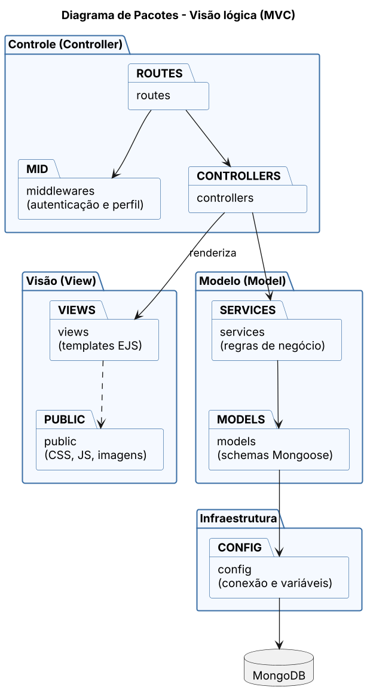
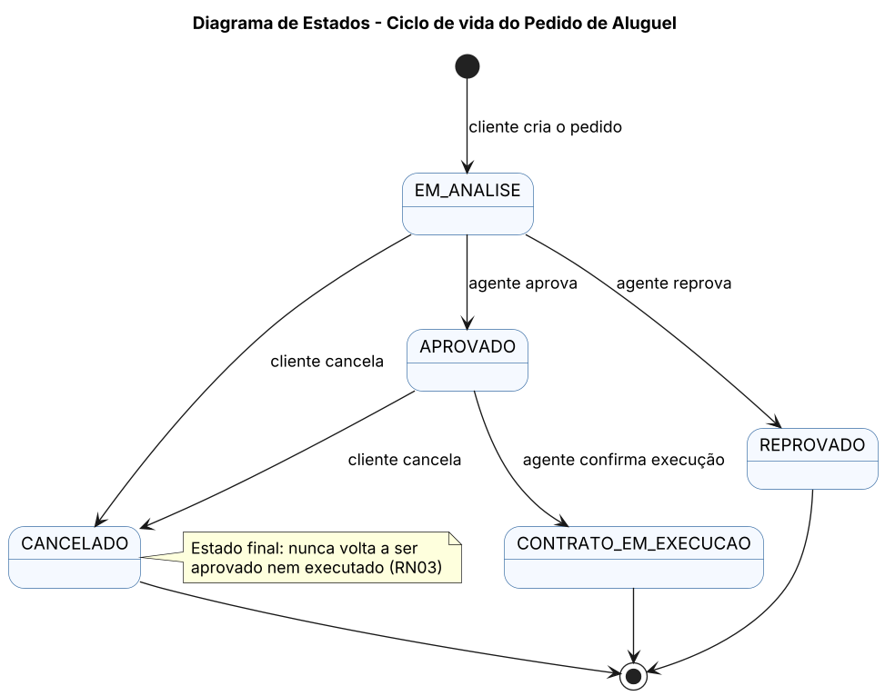

# 🚗 Alugô - Sistema Web de Aluguel de Automóveis 👨‍💻

> Plataforma web que conecta **clientes** a **agentes (empresas e bancos)**, organizando todo o fluxo de um pedido de aluguel: solicitação, análise financeira, aprovação e contrato.

<p align="center">
  <picture>
    <source media="(prefers-color-scheme: dark)" srcset="docs/img/logo-horizontal-dark.svg">
    
  </picture>
</p>

---

## 🚧 Status do Projeto


| Sprint | Entrega | Situação |
|---|---|---|
| 1 | Modelagem UML (casos de uso, classes, pacotes), histórias de usuário e documentação | ✅ Concluída |
| 2 | Implementação inicial | ⏳ Pendente |
| 3 | Versão final | ⏳ Pendente |

> As seções marcadas com 🚧 serão preenchidas nas próximas sprints, conforme o sistema for implementado.

---

## 📚 Índice

- [Links Úteis](#-links-úteis)
- [Sobre o Projeto](#-sobre-o-projeto)
- [Funcionalidades Principais](#-funcionalidades-principais)
- [Tecnologias Utilizadas](#-tecnologias-utilizadas)
- [Arquitetura](#-arquitetura)
- [Instalação e Execução](#-instalação-e-execução)
- [Deploy](#-deploy)
- [Estrutura de Pastas](#-estrutura-de-pastas)
- [Demonstração](#-demonstração)
- [Testes](#-testes)
- [Documentações utilizadas](#-documentações-utilizadas)
- [Autores](#-autores)
- [Contribuição](#-contribuição)
- [Agradecimentos](#-agradecimentos)
- [Licença](#-licença)

---

## 🔗 Links Úteis

- 💻 **Repositório:** [github.com/annaluizapsilva-03/Aluguel-automoveis](https://github.com/annaluizapsilva-03/Aluguel-automoveis)
- 🌐 **Demo Online:** 🚧 _a ser publicado após a Sprint 3_
- 📖 **Documentação do projeto:** [docs/README.md](docs/README.md)
  - [Regras de negócio](docs/regras-de-negocio.md)
  - [Histórias de usuário](docs/historias-de-usuario.md)
  - [Casos de uso](docs/casos-de-uso.md)
  - [Modelo de domínio e dicionário de dados](docs/modelo-de-dominio.md)
  - [Arquitetura e ciclo de vida do pedido](docs/arquitetura.md)
  - [Matriz de rastreabilidade](docs/rastreabilidade.md)
  - [Histórico de evolução dos modelos](docs/historico-de-modelagem.md)

---

## 📝 Sobre o Projeto

O **Alugô** apoia a gestão de pedidos de aluguel de automóveis. Hoje esse processo costuma depender de planilhas e contatos manuais, o que dificulta saber em que etapa está cada pedido e quem o analisou.

O sistema resolve isso centralizando o fluxo em dois perfis:

- **Cliente:** cadastra-se, informa seus vínculos de renda, cadastra automóveis, cria pedidos de aluguel e acompanha o status de cada um.
- **Agente (empresa ou banco):** consulta os pedidos pendentes, registra a avaliação financeira (aprovado ou reprovado, com justificativa) e, quando é banco, registra o contrato de crédito.

O projeto foi desenvolvido como **Trabalho Prático 2 - Aplicação Final** da disciplina de Desenvolvimento e Integração de Aplicações Web (PUC Minas), em três sprints que combinam modelagem UML e implementação de um protótipo funcional.

---

## ✨ Funcionalidades Principais

- 🔐 **Autenticação por perfil:** cadastro prévio obrigatório, com acesso diferente para Cliente e Agente.
- 👤 **CRUD de clientes:** nome, CPF, RG, endereço, profissão e até 3 empregadores com rendimento.
- 🚘 **CRUD de automóveis:** marca, modelo, ano, placa, matrícula e proprietário (cliente, empresa ou banco).
- 🏢 **Cadastro de agentes:** empresa ou banco, com CNPJ e endereço.
- 📝 **Pedidos de aluguel:** criar, consultar, editar e cancelar os próprios pedidos, com status atualizado.
- 💰 **Avaliação financeira:** o agente registra parecer, justificativa e data, ficando registrado como autor.
- 📄 **Contrato de crédito (opcional):** vinculado ao pedido e concedido apenas por agente do tipo banco.

> As regras de negócio completas estão em [docs/regras-de-negocio.md](docs/regras-de-negocio.md).

---

## 🛠 Tecnologias Utilizadas

> Tecnologias definidas na modelagem. As versões serão confirmadas na implementação (Sprint 2).

### 💻 Front-end (View)
- **Templates:** EJS, renderizado no servidor (mantém o padrão MVC)
- **Linguagem:** HTML5, CSS3 e JavaScript ES6+

### 🖥️ Back-end
- **Runtime:** Node.js 20 LTS
- **Framework:** Express
- **Banco de Dados:** MongoDB
- **ODM:** Mongoose
- **Autenticação:** sessões com senha protegida por hash

### ⚙️ Infraestrutura & Ferramentas
- **Containerização:** Docker Compose (MongoDB local)
- **Versionamento:** Git e GitHub
- **Modelagem:** UML com PlantUML

---

## 🏗 Arquitetura

O sistema segue o padrão **MVC** em quatro camadas lógicas:

| Camada | Pastas | Responsabilidade |
|---|---|---|
| View | `views`, `public` | Telas e arquivos estáticos. Não acessa o banco. |
| Controller | `routes`, `middlewares`, `controllers` | Recebe requisições, autentica, verifica o perfil e chama os serviços. |
| Model | `services`, `models` | Regras de negócio (RN) e schemas Mongoose. |
| Infraestrutura | `config` | Conexão com o MongoDB e variáveis de ambiente. |

**Decisões importantes:**
- Cliente e Agente herdam de Usuário, e ambos implementam a interface Proprietário, para que o dono de um automóvel possa ser cliente, empresa ou banco.
- Os rendimentos do cliente ficam em subdocumentos (máximo de 3).
- As regras de negócio ficam nos `services`; os controllers apenas orquestram.

### Diagramas

| Diagrama de Casos de Uso | Diagrama de Classes |
|---|---|
| [](docs/diagramas/casos-de-uso.png) | [](docs/diagramas/classes.png) |
| **Diagrama de Pacotes** | **Estados do Pedido** |
| [](docs/diagramas/pacotes.png) | [](docs/diagramas/estados-pedido.png) |

As fontes editáveis (PlantUML) estão em `docs/diagramas/*.puml`.

---

## 🔧 Instalação e Execução

### Pré-requisitos

- **Node.js:** versão 20 LTS ou superior
- **npm**
- **Docker** (opcional, recomendado para rodar o MongoDB)
- **Git**

### 🔑 Variáveis de Ambiente

O arquivo `.env.example` já traz as variáveis previstas. Para usá-lo:

```bash
cp .env.example .env
```

| Variável | Descrição | Exemplo |
|---|---|---|
| `PORT` | Porta onde a aplicação será executada | `3000` |
| `MONGODB_URI` | URL de conexão com o MongoDB | `mongodb://localhost:27017/aluguel_automoveis` |
| `SESSION_SECRET` | Chave usada para assinar as sessões | `troque-por-uma-chave-longa` |
| `NODE_ENV` | Ambiente de execução | `development` |

> ⚠️ Nunca versione o arquivo `.env`. Ele já está no `.gitignore`.

### 💾 Banco de Dados (MongoDB)

Com Docker:

```bash
docker compose up -d
```

Isso sobe um MongoDB em `localhost:27017`, conforme o `docker-compose.yml`. Para parar: `docker compose down`.

### 📦 Instalação de dependências e execução da aplicação

🚧 _A ser preenchido na Sprint 2, junto com a implementação (comandos `npm install`, `npm run dev` e `npm start`)._

---

## 🚀 Deploy

🚧 _A ser preenchido após a Sprint 3._

---

## 📂 Estrutura de Pastas

Estrutura atual do repositório (Sprint 1):

```
.
├── .env.example                 # 🧩 Exemplo das variáveis necessárias
├── .gitignore                   # 🧹 Arquivos ignorados pelo Git
├── README.md                    # 📘 Documentação principal
├── CONTRIBUTING.md              # 🤝 Guia de contribuição
├── LICENSE                      # ⚖️ Licença MIT
├── docker-compose.yml           # 🐳 MongoDB para desenvolvimento
│
└── /docs                        # 📚 Documentação e modelagem UML
    ├── README.md                # 🗂️ Índice da documentação
    ├── regras-de-negocio.md
    ├── historias-de-usuario.md
    ├── casos-de-uso.md
    ├── modelo-de-dominio.md
    ├── arquitetura.md
    ├── rastreabilidade.md
    ├── historico-de-modelagem.md
    ├── /diagramas               # 📐 Fontes .puml e imagens .png
    └── /img                     # 🖼️ Logo (SVG e PNG, versões clara e escura)
```

🚧 _As pastas do código-fonte (`src`, `public`, `tests`) serão adicionadas e descritas na Sprint 2, seguindo o diagrama de pacotes._

---

## 🎥 Demonstração

🚧 _Capturas de tela e GIFs serão adicionados após a implementação (Sprints 2 e 3)._

---

## 🧪 Testes

🚧 _A ser preenchido na Sprint 3._

---

## 🔗 Documentações utilizadas

- 📖 **Node.js:** [nodejs.org/docs](https://nodejs.org/docs/latest/api/)
- 📖 **Express:** [expressjs.com](https://expressjs.com/)
- 📖 **Mongoose:** [mongoosejs.com/docs](https://mongoosejs.com/docs/)
- 📖 **MongoDB:** [mongodb.com/docs](https://www.mongodb.com/docs/)
- 📖 **EJS:** [ejs.co](https://ejs.co/)
- 📖 **PlantUML:** [plantuml.com](https://plantuml.com/)
- 📖 **Conventional Commits:** [conventionalcommits.org](https://www.conventionalcommits.org/en/v1.0.0/)

---

## 👥 Autores

| 👤 Nome | 🖼️ Foto | 🎓 Matrícula | 🐙 GitHub | 💼 LinkedIn | 📤 E-mail |
|---|---|---|---|---|---|
| Anna Luiza Pereira Silva |  | 1656540 | [@annaluizapsilva-03](https://github.com/annaluizapsilva-03) | [annaluizapereira03](https://www.linkedin.com/in/annaluizapereira03/) | [annalumodascolonial@gmail.com](mailto:annalumodascolonial@gmail.com) |

---

## 🤝 Contribuição

1. Faça um `fork` do projeto.
2. Crie uma branch para sua feature (`git checkout -b feature/minha-feature`).
3. Faça commit das mudanças (`git commit -m 'feat: adiciona nova funcionalidade'`), usando [Conventional Commits](https://www.conventionalcommits.org/en/v1.0.0/).
4. Faça o `push` da branch (`git push origin feature/minha-feature`).
5. Abra um **Pull Request**.

> 📝 Veja o [`CONTRIBUTING.md`](CONTRIBUTING.md) para detalhes.

---


## 📄 Licença

Este projeto é distribuído sob a **[Licença MIT](LICENSE)**.
