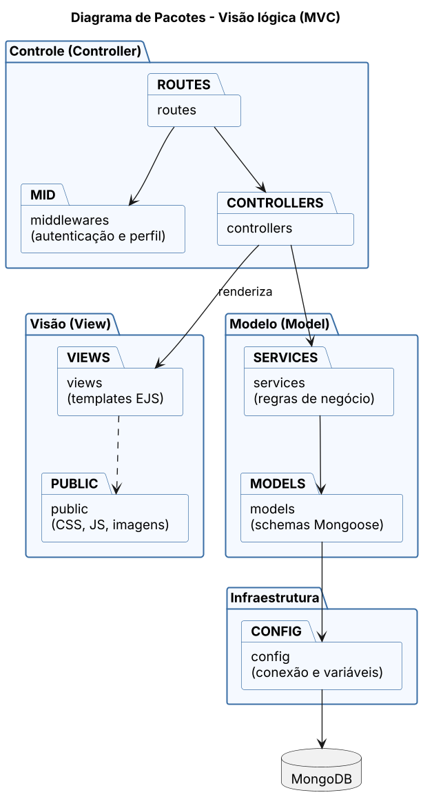
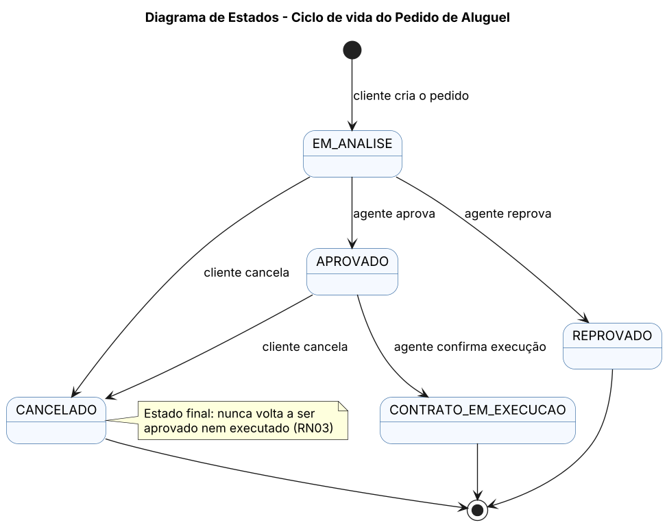

# Arquitetura

## Visão lógica (MVC)

| Camada | Pasta | Responsabilidade |
|---|---|---|
| View | `views`, `public` | Telas e arquivos estáticos. Não acessa o banco. |
| Controller | `routes`, `middlewares`, `controllers` | Recebe requisições, autentica, verifica perfil e chama os serviços. |
| Model | `services`, `models` | Regras de negócio (RN) e schemas Mongoose. |
| Infraestrutura | `config` | Conexão com o MongoDB e variáveis de ambiente. |

Tecnologias planejadas: Node.js, Express, EJS, Mongoose e MongoDB.

Regra de dependência: a View nunca fala com o banco; o Controller nunca contém regra de negócio, apenas orquestra; as regras ficam nos services.

## Ciclo de vida do pedido

As transições permitidas são as das regras RN03, RN10, RN11, RN12 e RN13, detalhadas em [regras-de-negocio.md](regras-de-negocio.md).
