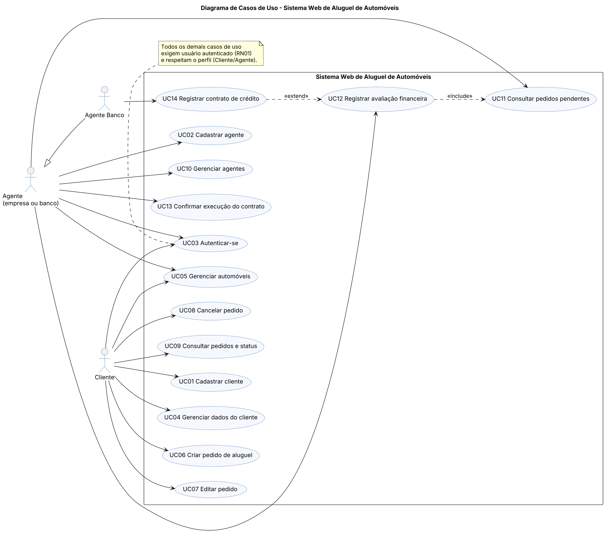

# Casos de Uso

Atores: **Cliente**, **Agente** (empresa ou banco) e **Agente Banco** (especialização do Agente, único que registra contrato de crédito).
Todos os casos de uso, exceto UC01, UC02 e UC03, exigem usuário autenticado (RN01).

## Resumo

| UC | Nome | Ator | Histórias |
|---|---|---|---|
| UC01 | Cadastrar cliente | Cliente | HU01 |
| UC02 | Cadastrar agente | Agente | HU09 |
| UC03 | Autenticar-se | Cliente, Agente | HU02 |
| UC04 | Gerenciar dados do cliente | Cliente | HU03 |
| UC05 | Gerenciar automóveis | Cliente, Agente | HU04, HU15 |
| UC06 | Criar pedido de aluguel | Cliente | HU05 |
| UC07 | Editar pedido | Cliente | HU06 |
| UC08 | Cancelar pedido | Cliente | HU07 |
| UC09 | Consultar pedidos e status | Cliente | HU08 |
| UC10 | Gerenciar agentes | Agente | HU10 |
| UC11 | Consultar pedidos pendentes | Agente | HU11 |
| UC12 | Registrar avaliação financeira | Agente | HU12 |
| UC13 | Confirmar execução do contrato | Agente | HU13 |
| UC14 | Registrar contrato de crédito | Agente Banco | HU14 |

## Especificações detalhadas

### UC06 - Criar pedido de aluguel
- **Ator:** Cliente autenticado
- **Pré-condições:** cliente logado; existe ao menos um automóvel cadastrado
- **Fluxo principal:**
  1. O cliente acessa "Novo pedido".
  2. O sistema lista os automóveis disponíveis.
  3. O cliente escolhe o automóvel e informa data de início e de fim.
  4. O sistema valida o período (RN15) e a ausência de conflito (RN16).
  5. O sistema cria o pedido com status Em análise e data de criação atual.
  6. O sistema exibe o pedido na lista do cliente.
- **Fluxos alternativos:**
  - 4a. Período inválido: o sistema mostra o erro e mantém os dados preenchidos.
  - 4b. Automóvel já reservado no período: o sistema recusa e informa o conflito.
- **Pós-condição:** pedido Em análise associado ao cliente e ao automóvel.

### UC08 - Cancelar pedido
- **Ator:** Cliente autenticado
- **Pré-condições:** o pedido pertence ao cliente e está Em análise ou Aprovado
- **Fluxo principal:**
  1. O cliente abre seus pedidos e escolhe "Cancelar".
  2. O sistema pede confirmação.
  3. O cliente confirma.
  4. O sistema altera o status para Cancelado.
- **Fluxos alternativos:**
  - 1a. Pedido em outro status: a opção não é oferecida e a requisição direta é recusada (RN11).
  - 3a. O cliente desiste: nada é alterado.
  - 1b. Pedido de outro cliente: acesso negado (RN02).
- **Pós-condição:** pedido Cancelado, que não pode mais ser aprovado nem executado (RN03).

### UC12 - Registrar avaliação financeira
- **Ator:** Agente autenticado
- **Pré-condições:** existe pedido Em análise
- **Fluxo principal:**
  1. O agente consulta os pedidos pendentes (UC11).
  2. Abre um pedido e vê dados do cliente, rendimentos e automóvel.
  3. Escolhe o parecer (aprovado ou reprovado) e escreve a justificativa.
  4. O sistema grava a avaliação com o agente logado e a data atual (RN05).
  5. O sistema atualiza o status do pedido para Aprovado ou Reprovado.
- **Fluxos alternativos:**
  - 3a. Justificativa vazia: o sistema exige o preenchimento.
  - 4a. O pedido foi cancelado ou já avaliado enquanto o agente analisava: o sistema recusa e informa o status atual (RN03, RN12).
  - 1a. Usuário sem perfil de agente: acesso negado (RN04).
- **Pós-condição:** avaliação registrada e status atualizado.

### UC14 - Registrar contrato de crédito
- **Ator:** Agente do tipo banco
- **Pré-condições:** pedido Aprovado ou Contrato em execução, sem contrato de crédito
- **Fluxo principal:**
  1. O agente banco abre o pedido.
  2. Escolhe "Registrar contrato de crédito".
  3. Informa valor financiado, prazo em meses e situação.
  4. O sistema valida que o agente é do tipo banco (RN07) e grava o contrato vinculado ao pedido.
- **Fluxos alternativos:**
  - 2a. Agente do tipo empresa: a opção não aparece e a requisição direta é recusada.
  - 3a. Valor ou prazo inválidos (menores ou iguais a zero): o sistema pede correção.
- **Pós-condição:** pedido associado a um contrato de crédito.

### UC01 - Cadastrar cliente
- **Ator:** Cliente (ainda sem conta)
- **Fluxo principal:**
  1. O cliente abre "Criar conta".
  2. Informa nome, e-mail, senha, CPF, RG, endereço e profissão.
  3. Adiciona de 0 a 3 empregadores com rendimento.
  4. O sistema valida os dados e a unicidade de CPF e e-mail (RN14).
  5. O sistema grava o cliente com perfil Cliente e senha em hash.
- **Fluxos alternativos:**
  - 4a. CPF ou e-mail já existente: o sistema informa qual campo conflita.
  - 3a. Tentativa de adicionar quarto empregador: o sistema bloqueia (RN06).
- **Pós-condição:** cliente cadastrado, apto a entrar no sistema.
