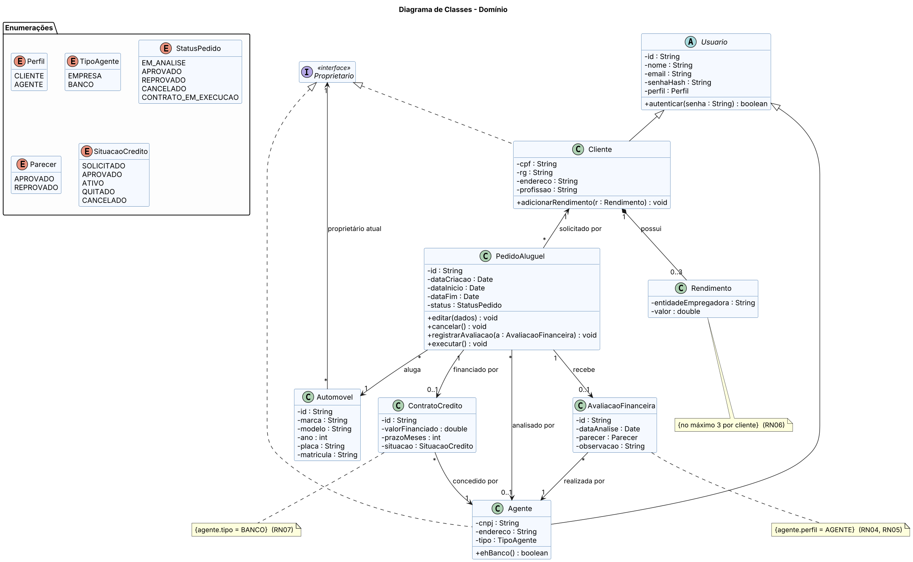

# Modelo de Domínio

## Decisões de modelagem
1. **Herança de Usuário:** Cliente e Agente herdam nome, e-mail, senha e perfil, o que simplifica login e controle de acesso.
2. **Interface Proprietário:** o dono de um automóvel pode ser cliente, empresa ou banco. Como empresa e banco são Agentes, tanto Cliente quanto Agente implementam Proprietário (RN08). No MongoDB isso será guardado como tipo e identificador do proprietário.
3. **Rendimentos como composição:** Rendimento só existe dentro de um Cliente, com limite de 3 (RN06). Será um subdocumento do cliente.
4. **Avaliação como classe própria:** guarda agente, data, parecer e justificativa, o que preserva o histórico da análise (RN05).
5. **Contrato de crédito opcional:** associação 0..1 com o pedido e obrigatoriamente com um agente banco (RN07).
6. **Quem cadastra automóveis:** o enunciado não define, então cliente e agente podem cadastrar (HU04 e HU15).

## Dicionário de dados

### Usuario (abstrata)
| Atributo | Tipo | Regra |
|---|---|---|
| id | texto | gerado pelo banco |
| nome | texto | obrigatório |
| email | texto | obrigatório, único |
| senhaHash | texto | obrigatório, nunca em texto puro |
| perfil | Perfil | CLIENTE ou AGENTE |

### Cliente
| Atributo | Tipo | Regra |
|---|---|---|
| cpf | texto | obrigatório, único, 11 dígitos |
| rg | texto | obrigatório |
| endereco | texto | obrigatório |
| profissao | texto | obrigatório |
| rendimentos | lista de Rendimento | de 0 a 3 itens |

### Rendimento
| Atributo | Tipo | Regra |
|---|---|---|
| entidadeEmpregadora | texto | obrigatório |
| valor | decimal | maior que zero |

### Agente
| Atributo | Tipo | Regra |
|---|---|---|
| cnpj | texto | obrigatório, único, 14 dígitos |
| endereco | texto | obrigatório |
| tipo | TipoAgente | EMPRESA ou BANCO |

### Automovel
| Atributo | Tipo | Regra |
|---|---|---|
| marca, modelo | texto | obrigatórios |
| ano | inteiro | entre 1900 e ano atual + 1 |
| placa | texto | obrigatória, única |
| matricula | texto | obrigatória (identificador do veículo) |
| proprietario | referência | cliente ou agente (RN08) |

### PedidoAluguel
| Atributo | Tipo | Regra |
|---|---|---|
| cliente | referência | obrigatório, o solicitante |
| automovel | referência | obrigatório |
| dataCriacao | data | preenchida pelo sistema |
| dataInicio, dataFim | data | período válido (RN15) |
| status | StatusPedido | começa em EM_ANALISE |
| agenteResponsavel | referência | preenchido na avaliação |
| avaliacao | AvaliacaoFinanceira | 0..1 |
| contratoCredito | ContratoCredito | 0..1 |

### AvaliacaoFinanceira
| Atributo | Tipo | Regra |
|---|---|---|
| agente | referência | obrigatório, o autor da análise |
| dataAnalise | data | preenchida pelo sistema |
| parecer | Parecer | APROVADO ou REPROVADO |
| observacao | texto | obrigatória |

### ContratoCredito
| Atributo | Tipo | Regra |
|---|---|---|
| banco | referência a Agente | tipo BANCO (RN07) |
| valorFinanciado | decimal | maior que zero |
| prazoMeses | inteiro | maior que zero |
| situacao | SituacaoCredito | SOLICITADO, APROVADO, ATIVO, QUITADO ou CANCELADO |

## Glossário
- **Agente:** empresa ou banco que analisa pedidos financeiramente.
- **Pedido ativo:** pedido Em análise, Aprovado ou Contrato em execução.
- **Parecer:** decisão do agente sobre o pedido (aprovado ou reprovado).
